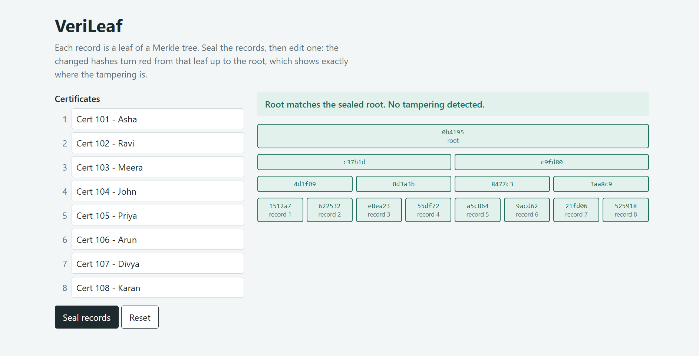
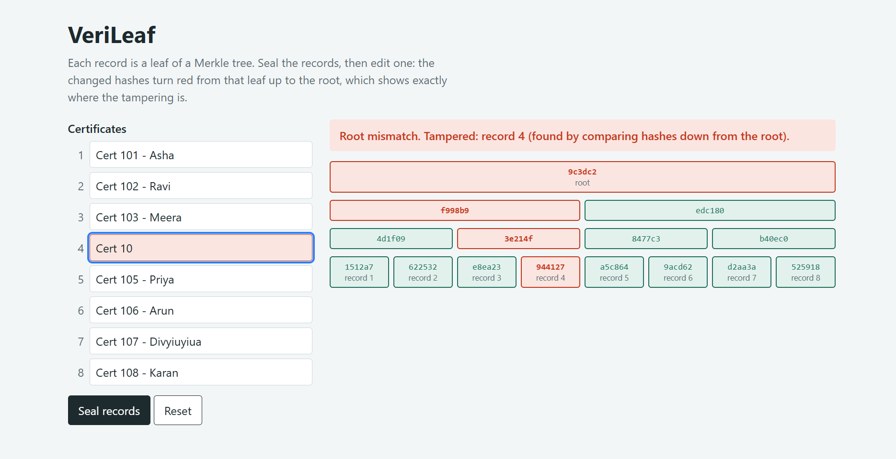

# VeriLeaf: Tamper-Evident Record Verification Using Merkle Trees

VeriLeaf detects tampering in digital records and pinpoints exactly which record was changed,
using a Merkle (hash) tree built in Python.

## Files

| File | Purpose |
|---|---|
| `merkle.py` | Build and manage the Merkle tree |
| `proofs.py` | Generate and verify Merkle proofs |
| `diff.py` | Compare trees and find changed records |
| `datasets.py` | Generate sample records |
| `benchmark.py`, `plot_results.py` | Benchmark performance and plot results |
| `demo.py`, `proof_demo.py` | Run command-line demonstrations |
| `index.html` | Visual dashboard |
| `test_*.py` | Unit tests |

## Run

Requires Python 3.8 or later.

Install dependencies first (installs matplotlib and pytest):

```bash
pip install -r requirements.txt
```

Then run:

```bash
python -m pytest -v
python demo.py
python proof_demo.py
python benchmark.py
python plot_results.py
```

## Complexity

| Operation | Time Complexity |
|---|---|
| Build the tree | O(n) |
| Verify one record using a proof | O(log n) |
| Update one record | O(log n) |
| Locate k tampered records | O(k log n) |
| Append a record | O(n) |

## Screenshots





## Team

| Member | Contribution |
|---|---|
| Sahana Arunprasath | Core Merkle tree, repository setup, reviews |
| Kanishka S | Proofs and finding changed records |
| Haricharan | Sample data, benchmark and graph |
| Sanjana Chowdhary | Dashboard, demo and documentation |

## Note on AI assistance

The initial code was AI-assisted. The team reviewed, tested and extended it, and each member can explain the part they worked on.