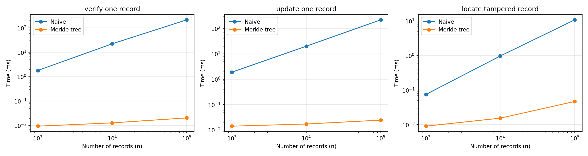

# VeriLeaf Benchmark Results

## What was measured

Three operations were timed for n = 1,000, 10,000, and 100,000 records:

- **Verify one record** — rebuild the whole tree from every record and compare roots (naive) vs. check a Merkle proof (tree).
- **Update one record** — rebuild the whole tree after changing one record (naive) vs. call `tree.update` which recomputes only the path from the changed leaf to the root (tree).
- **Locate a tampered record** — scan every leaf hash until one differs (naive) vs. walk down the tree with `find_changed`, skipping any subtree whose root hash already matches (tree).

## Results

| n | Task | Naive (ms) | Tree (ms) |
|---|---|---:|---:|
| 1,000 | verify one record | 1.8040 | 0.0094 |
| 1,000 | update one record | 1.8942 | 0.0142 |
| 1,000 | locate tampered record | 0.0744 | 0.0090 |
| 10,000 | verify one record | 22.2804 | 0.0129 |
| 10,000 | update one record | 19.9797 | 0.0173 |
| 10,000 | locate tampered record | 0.9688 | 0.0153 |
| 100,000 | verify one record | 212.6494 | 0.0205 |
| 100,000 | update one record | 217.5706 | 0.0245 |
| 100,000 | locate tampered record | 10.7501 | 0.0467 |

## What the graph shows

For all three tasks, the naive time grows roughly in proportion to n (multiplying n by 10 multiplies the naive time by about 10). The tree times stay nearly flat across all values of n. At n = 100,000, the tree is approximately 10,000 times faster than the naive approach for verify and update, and about 230 times faster for locate.

The axes are logarithmic so that both the flat tree lines and the steeply rising naive lines are visible on the same plot. On a linear scale the tree times would be indistinguishable from zero.

## Limitations

- Timings depend on hardware, operating system, and Python version; results on other machines may differ.
- Building the tree is still O(n) and is not included in any of the timed operations above; the tree is always constructed outside the measured section.
